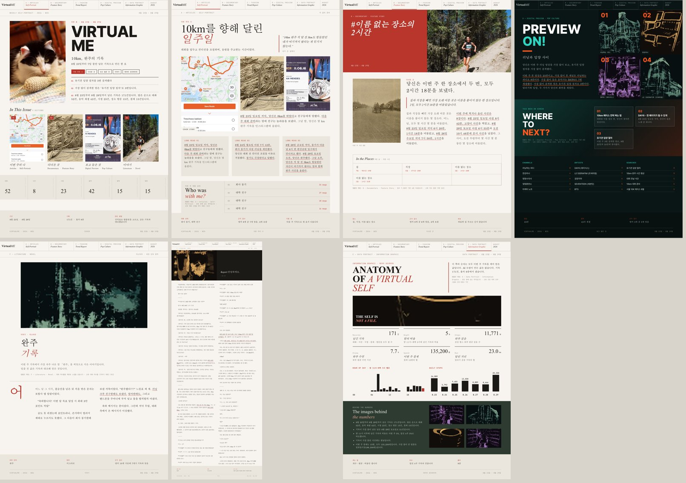
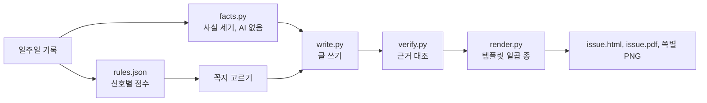

# 웹진: 일주일 기록으로 한 호를 자동으로 만듭니다

## 결론

일주일(또는 하루) 기록을 넣으면 규칙표가 템플릿을 고르고, 문지현 선생님의 VirtualME 템플릿 일곱 종 디자인으로
웹진 한 호를 HTML 과 A4 PDF 로 만듭니다. 가상 인물 윤서연의 8월 23~29일 기록(171건)으로 만든 호는 1분 30초쯤
걸렸고, 소설의 근거 앵커 6개가 모두 기록과 맞았습니다.

정할 것은 다음 두 가지입니다.

1. **규칙표 값**: 실제 기록으로 한두 호를 만들어 본 뒤, 어색하게 짝지어진 템플릿의 `weight` 와 `min_score` 를 고칩니다.
2. **실제 기록 범위**: 7회차에는 한 사람의 기록을 최소 일주일치 넣어야 합니다.

가장 큰 한계는 아직 가상 인물 기록으로만 시험했다는 점입니다. 실제 기록은 출처 구성이 달라서 꼭지가 다르게 골릴 수 있습니다.

> **여기부터 보세요**: 아래 샘플 한 호와 `rules.json`



## 한 호는 표지와 규칙표가 고른 꼭지로 이루어집니다



| 꼭지 | 템플릿 | 들어가는 것 |
|---|---|---|
| 표지 | A 계열 | 이번 호 제목, 사실과 대조해 맞는 표지 문구 세 줄, 차례, 기록 종류별 건수 |
| 이번 주의 나 | A Articles | 대화 상대 중심 기사, 내가 쓴 글 인용, 대화 상대 순위 |
| 다녀온 곳 | B Documentary | 머문 장소와 시간, 그 주 사진 |
| 이번 주의 룩 | C Fashion | 셀카와 옷 사진, 옷이나 화장품 결제, 관련 검색 |
| 보고 들은 것 | D Digital Preview | 영상 채널, 음악가, 검색어 |
| 데이터 포트레이트 | E Data Portrait | 숫자 카드, 시간대 막대, 날짜별 걸음 수 (AI 없이 센 값만) |
| 이야기 | F Novel | 그 주 대표 낱말을 씨앗으로 노벨 화면과 같은 프롬프트로 쓴 소설, 분량에 따라 두세 쪽 |
| 시 | G Poem | 그 주 혼잣말형 글(게시물, 스토리, 밤에 쓴 글)로 쓴 시 |

## 매칭은 rules.json 만 고치면 바뀝니다

신호 하나는 기록 조건(`match`)과 올릴 템플릿, 기록 한 건당 점수(`weight`)로 되어 있습니다. 조건 키는 `kinds`(기록 종류),
`self`(내가 쓴 것만), `has_text`, `written`(글로 쓴 기록), `hours`(시각), `photo_tags`(사진 자동 태그),
`categories`(카드 결제 업종, 부분 일치), `terms`(본문이나 검색어, 영상 제목에 든 낱말)입니다.

그 주 점수가 `templates.<키>.min_score` 이상이면 꼭지로 싣고, `always: true` 인 꼭지는 늘 싣습니다. 이야기 꼭지는
`story_pick` 기준으로 소설과 시 가운데 고릅니다. 지금 기본값은 독백형 글을 시로, 셀카와 옷, 화장품 기록을 패션으로,
시청과 음악, 검색을 디지털 프리뷰로, 지도 방문과 풍경 사진, 여행 결제를 다큐로 보냅니다. 점수와 신호별 건수, 실린
이유는 `issue.json` 의 `sections` 와 앱 웹진 화면 왼쪽에 그대로 나옵니다.

## 글은 기록과 대조한 값만 강조합니다

`facts.py` 는 그 주 기록을 앞선 4주와 견주어 사실 문장을 셉니다. 사실마다 근거 기록 ID 와 검사용 값을 붙입니다.
`write.py` 는 글 속 값을 `<em ref="번호">` 로 감싸게 하고, 근거 계약 v2 검사기가 기록이나 사실과 대조합니다. 맞지 않는
값은 흐리게 바꿉니다. 그리고 앵커가 없는 표지 문구는 수치나 날짜가 확인되지 않으면 싣지 않고, 시는 숫자가 든 행을
싣지 않습니다. 그림 자리는 그 주 사진을 먼저 쓰고, 모자라면 팀 StyleGAN 잠재공간 영상의 프레임을 씁니다.

실명은 가져올 때 가명으로 바뀌고 글에서는 관계("회사 동기")로 부릅니다. 좌표와 집 주소는 싣지 않습니다.
LLM 으로 나가는 글은 다른 기능처럼 `outbound` 검사를 거치고 로그에 남습니다.

## 돌려 보는 법은 명령 한 줄입니다

```bash
cd core
export OPENROUTER_API_KEY=sk-or-v1-...       # 없으면 사실 문장과 기록 문장만으로 만든다 (--offline 과 같음)
uv run virtueme -p seoyeon webzine           # 기록의 마지막 7일
uv run virtueme -p seoyeon webzine --end 2026-07-12
uv run virtueme -p seoyeon webzine --days 1  # 하루치 호
```

앱에서는 맨 앞 `WEBZINE 웹진` 모드에서 「이번 호 만들기」를 누릅니다. core 서버가 켜져 있어야 합니다.
API 는 `POST /webzine {"days":7}` 로 시작하고, `GET /webzine/job/<작업>` 으로 기다린 뒤 `GET /webzine/<호>/issue.html` 로 엽니다.
결과는 `$VIRTUEME_DATA/webzine/<프로필>/<호>/` 에 남습니다.
